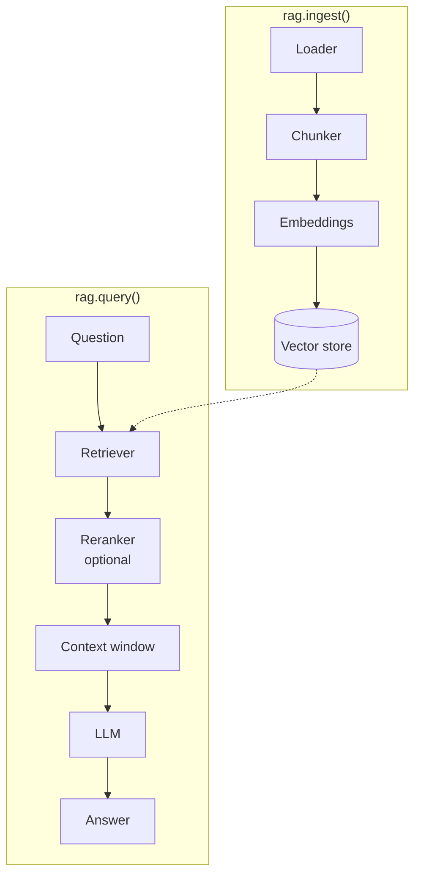

# Core concepts

This page explains each part of a ragfoundry pipeline and the terms you'll meet in the rest of the
docs.

## Configuration

Everything about a pipeline is set in one `RAGConfig`, written as a Python dict or a YAML file.
Each part of the pipeline has its own section (`embeddings`, `vector_store`, `llm`, `chunking`,
`retrieval` ...). Only `embeddings`, `vector_store` and `llm` are required; every other setting
has a sensible default. See [Configure with Python or YAML](../how-to/configuration.md).

## Pipeline

`RAGPipeline` is the object you use. Create it once and reuse it: it holds model clients and
database connections.

| Method | Does |
|---|---|
| `ingest(paths_or_urls)` | Load, chunk, embed and store documents |
| `query(question)` | Answer a question |
| `chat()` | Start a conversation with memory |
| `retrieve(question)` | Find passages without generating an answer |
| `stream(question)` | Answer word by word as it is generated |
| `evaluate(dataset)` | Measure quality |
| `sources()` / `delete_source(path)` | See and remove indexed documents |

## Document and metadata

A **document** is a piece of text plus **metadata**: facts about where it came from, such as the
file path (`source`), file type and page number. Metadata is kept through every step, so you can
show citations and [filter searches](../how-to/metadata-filters.md).

## Loader

A **loader** reads a file or web page into documents. ragfoundry picks the loader from the file
extension. See [Document loaders](../integrations/loaders/index.md).

## Chunk and chunking

LLMs work best with short, focused passages, and search is more precise when each passage covers
one topic. **Chunking** splits documents into **chunks** of a set size (for example 1,000
characters) that slightly **overlap**, so a sentence cut at a boundary still appears whole in one
of them. See [Chunking strategies](../integrations/chunking/index.md) and
[Choose chunk size](../how-to/chunk-size.md).

## Embedding and vector

An **embedding model** turns text into a **vector**: a list of a few hundred numbers. Texts with
similar meaning get similar vectors, even when they use different words ("refund" and "money
back"). The question is embedded the same way, and the closest chunk vectors are found. See
[Embedding models](../integrations/embeddings/index.md).

!!! warning
    Chunks and questions must be embedded with the **same** model. If you change embedding model,
    re-index into a new collection; ragfoundry refuses to mix two models in one collection.

## Vector store and collection

A **vector store** (vector database) stores chunk vectors and finds the nearest ones quickly. A
**collection** is one named set of documents inside it; use different `collection_name`s for
unrelated datasets. See [Vector stores](../integrations/vector-stores/index.md).

## Retrieval

**Retrieval** is finding the best chunks for a question. ragfoundry can combine:

- **vector search**: by meaning (always on),
- **[hybrid search](../how-to/hybrid-search.md)**: adds keyword search, which helps with names,
  codes and numbers,
- **[reranking](../how-to/reranking.md)**: a second, more careful model re-orders the candidates,
- **[query transforms](../how-to/query-transforms.md)**: the LLM rephrases the question first,
- **[corrective retrieval](../how-to/corrective-retrieval.md)**: the LLM checks the chunks and
  searches again if they are not relevant.

`top_k` is how many chunks are given to the LLM (default 5). `fetch_k` is how many candidates are
gathered before reranking or fusion (default 20).

## Context window

The **context window** is the amount of text an LLM can read in one request, measured in
**tokens** (roughly ¾ of a word). The prompt holds the instructions, the retrieved chunks, the chat
history and the question. ragfoundry can cap the chunks and history to a
[token budget](../how-to/context-window.md).

## Generation

The LLM receives the retrieved chunks numbered `[1]`, `[2]` ... and is instructed to answer only
from them and cite them, and to say so when they don't contain the answer.

ragfoundry **abstains** (returns a fixed "I don't have enough information" message without
calling the LLM) when retrieval returns nothing at all: an empty index, a
[filter](../how-to/metadata-filters.md) that matches nothing, or
[corrective retrieval](../how-to/corrective-retrieval.md) rejecting every passage.

## Result

`query()` returns a `RAGResult`:

| Field | Contents |
|---|---|
| `answer` | The answer text, with `[n]` citations |
| `sources` | The files or URLs used, best first |
| `documents` | The chunks given to the LLM, with metadata |
| `abstained` | `True` if the pipeline declined to answer |
| `queries` | Every search query used |
| `standalone_question` | In a chat, the follow-up rewritten as a full question |
| `context_tokens` | How many tokens of chunks were sent |

## Ingestion is incremental

ragfoundry remembers every chunk it has stored (in `persist_dir`, default `.ragfoundry/`).
Running `ingest` again only embeds new or changed chunks and removes ones that disappeared, so
keeping the index up to date is cheap. See [Keep the index up to date](../how-to/managing-the-index.md).

## LangChain and LangGraph

ragfoundry is built on [LangChain](https://python.langchain.com) components and runs each
ingestion and query as a [LangGraph](https://langchain-ai.github.io/langgraph/) workflow. You
don't need to know either to use ragfoundry, but you can plug any LangChain model or vector store
in: see [Custom components](../how-to/custom-components.md).
