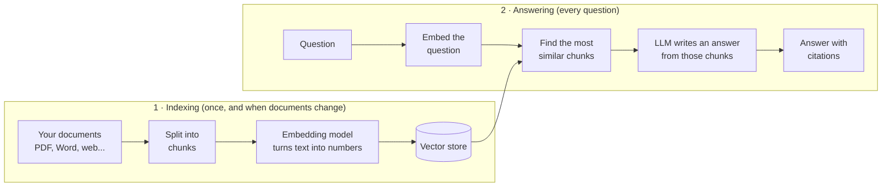

# What is RAG?

**RAG (retrieval-augmented generation)** is a way to make a large language model (LLM) such as
ChatGPT, Llama or Claude answer questions using *your* documents.

## The problem RAG solves

An LLM only knows what was in its training data. It has never seen your company handbook, your
product manuals or last week's meeting notes. If you ask about them, it either says it doesn't
know or, worse, makes something up.

You can't paste all your documents into every question either: there may be thousands of pages,
and LLMs have a limit on how much text they can read at once (the *context window*).

## The idea

RAG works like an open-book exam:

1. **Before any questions**, your documents are split into small passages and stored in a
   searchable index.
2. **When a question arrives**, the most relevant passages are found in the index.
3. **The LLM receives the question plus those passages**, and writes an answer based on them,
   citing where each fact came from.

The LLM never needs to have seen your documents before. It only reads the few passages that matter
for each question.

## The parts of a RAG system

| Part | What it does | Analogy |
|---|---|---|
| **Document loader** | Reads PDFs, Word files, web pages and so on into plain text | Photocopying the books |
| **Chunker** | Cuts the text into passages of a few hundred words | Cutting pages into index cards |
| **Embedding model** | Turns each passage into a list of numbers (a *vector*) that captures its meaning | Writing a summary code on each card |
| **Vector store** | A database that finds the passages whose meaning is closest to the question | The card catalogue |
| **Retriever** | Searches the vector store (and optionally does keyword search) | The librarian |
| **LLM** | Reads the question and the retrieved passages, and writes the answer | The student writing the exam |

ragfoundry provides every one of these parts. You pick which ones to use in a configuration, and
it connects them for you.

## Why not just fine-tune the model?

Fine-tuning (training the model further on your data) is expensive, slow to update, and still
doesn't tell you *where* an answer came from. RAG:

- works with any LLM, with no training,
- updates instantly when documents change: just index the new ones,
- shows the sources of every answer, so users can check them,
- keeps private documents out of the model itself.

## Next

[Install ragfoundry](installation.md) and build your [first pipeline](first-pipeline.md).
