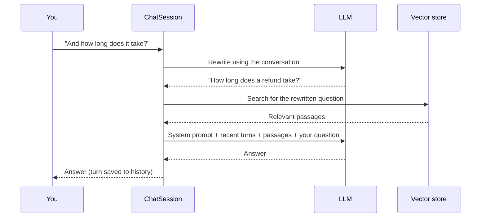

# Chat with history

A plain `rag.query()` treats every question on its own. In a conversation, people ask follow-ups
like "and how long does that take?", which mean nothing without the earlier messages. ragfoundry
handles this for you.

## Start a conversation

```python
chat = rag.chat()

chat.ask("What does the refund policy say?")
result = chat.ask("And how long does it take?")

print(result.answer)
print(result.standalone_question)   # "How long does a refund take under the refund policy?"
```

## What happens on each follow-up



1. **Rewriting.** The LLM turns the follow-up into a standalone question
   (`result.standalone_question`), and that's what is searched. Searching "and how long does it
   take?" on its own would find nothing useful.
2. **History in the prompt.** The most recent turns are sent with the passages, so the answer can
   refer back to the conversation. The question is passed in your own words.

The first question of a conversation has no history, so it isn't rewritten and costs no extra LLM
call.

## ChatSession methods

| Method | Does |
|---|---|
| `ask(question, where=None, top_k=None)` | Answer and record the turn; returns a `RAGResult` |
| `stream(question)` | Yield the answer as it is generated; records the turn when finished |
| `aask(question)`, `astream(question)` | Async versions |
| `history` | The conversation as LangChain messages |
| `to_dicts()` | The conversation as a list of `{"role", "content"}` dicts, roles `user` and `assistant` |
| `reset()` | Forget everything |
| `len(chat)` | Number of completed turns |

## Save and resume a conversation

Sessions live in memory. To keep one across restarts, save `to_dicts()` and pass it back:

```python
import json

json.dump(chat.to_dicts(), open("chat.json", "w"))

chat = rag.chat(json.load(open("chat.json")))
chat.ask("What did we talk about?")
```

## Manage history yourself

If your app already stores messages (in a database, for example), pass them straight to `query`,
`stream`, `aquery`, `astream` or `retrieve`:

```python
history = [
    {"role": "user", "content": "What does the refund policy say?"},
    {"role": "assistant", "content": "Refunds are issued within five business days [1]."},
]
result = rag.query("Who approves them?", history=history)
```

History items can be dicts with `role` and `content`, `(role, content)` tuples, or LangChain
`HumanMessage` / `AIMessage` objects. Roles are `user` or `human`, and `assistant` or `ai`.
System messages are ignored.

## Control how much history is sent

```python
"context_window": {
    "max_history_turns": 5,          # last 5 questions with their answers (default)
    "max_history_tokens": 1500,      # and no more than ~1,500 tokens of them
    "condense_question": True,       # rewrite follow-ups before searching (default)
}
```

- Whole turns are dropped, oldest first, so the LLM never sees an answer without its question.
- `max_history_turns: 0` turns history off completely (and skips rewriting).
- `condense_question: false` searches with the question exactly as typed. This saves one LLM call
  per question, but follow-ups retrieve worse.
- The session always keeps the full history; these limits only affect what each request sends.

See [Limit the context window](context-window.md) for token budgets.

## One session per user

Create the pipeline once and a `ChatSession` for each conversation; sessions share the pipeline's
models and connections. The [Streamlit](../tutorials/streamlit-app.md) and
[FastAPI](../tutorials/fastapi-chatbot.md) tutorials show this.

## Troubleshooting

- **Follow-ups find the wrong documents.** Print `result.standalone_question`. Small local models
  sometimes rewrite badly; try a stronger model.
- **The answer ignores earlier turns.** Check `max_history_turns` isn't 0 and
  `max_history_tokens` isn't so small that everything is dropped.
