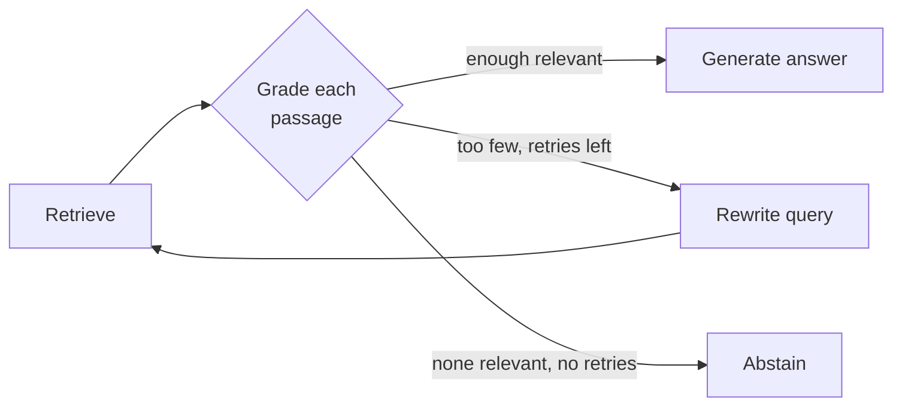

# Corrective retrieval

Sometimes retrieval returns passages that look similar to the question but don't actually answer
it. Corrective retrieval asks the LLM to **grade** each retrieved passage, drops the irrelevant
ones, and if too few remain, **rewrites the query** and searches again.

```python
"retrieval": {
    "corrective": {
        "enabled": True,
        "max_retries": 1,           # extra search rounds allowed
        "min_relevant_docs": 1,     # retry when fewer relevant passages than this
    },
}
```



## What you gain

- Fewer answers built on irrelevant passages, because those are removed before generation.
- A second chance when the first query was poor.
- Honest "I don't know" answers when nothing relevant exists.

## What it costs

One LLM call **per passage** per round, plus one for each rewrite. With `top_k: 5` and one retry,
a question can take up to 11 extra LLM calls. Use a fast, cheap model, or turn this on only where
accuracy matters more than speed.

## Results

```python
result = rag.query("What's the penalty for late delivery?")
print(result.retries)       # how many rewrite rounds ran
print(result.queries)       # the original and rewritten queries
print(result.abstained)     # True if nothing relevant was found after all retries
```

## Tips

- Small models can be too strict or too lenient graders. If many good answers turn into "I don't
  know", try a stronger model or turn corrective retrieval off.
- Combine with [reranking](reranking.md): reranking orders the candidates, grading removes the bad
  ones.
