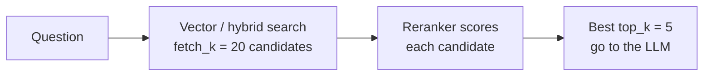

# Reranking

First-stage retrieval is fast but approximate: it compares the question and each passage
separately. A **reranker** reads the question and each candidate passage *together* and scores
how well the passage answers it. That's much more accurate, but too slow to run over the whole
index, so it's run only on the top candidates.



## Turn it on

=== "Local (free)"

    ```bash
    pip install "ragfoundry[huggingface]"
    ```

    ```python
    "retrieval": {
        "top_k": 5,
        "fetch_k": 20,
        "rerank": {"provider": "huggingface", "model": "cross-encoder/ms-marco-MiniLM-L-6-v2"},
    }
    ```

=== "Cohere (hosted)"

    ```bash
    pip install "ragfoundry[cohere]"
    export COHERE_API_KEY="..."
    ```

    ```python
    "retrieval": {
        "top_k": 5,
        "fetch_k": 30,
        "rerank": {"provider": "cohere", "model": "rerank-v3.5"},
    }
    ```

## Choosing `fetch_k`

The reranker can only promote passages that first-stage retrieval found. A larger `fetch_k` gives
it more to choose from, at the cost of time: a local cross-encoder takes roughly 5 to 20 ms per
candidate on a CPU. 20 to 50 is a good range.

## Scores

Reranked passages carry `metadata["rerank_score"]`. Higher is better; the scale depends on the
model.

```python
for doc in rag.retrieve("How long do refunds take?"):
    print(round(doc.metadata["rerank_score"], 2), doc.page_content[:60])
```

## Which model

| Model | Notes |
|---|---|
| `cross-encoder/ms-marco-MiniLM-L-6-v2` | Small and fast; a good default for English |
| `BAAI/bge-reranker-base` | More accurate, slower; multilingual |
| Cohere `rerank-v3.5` | Hosted, multilingual, nothing to run |

Integration pages: [Hugging Face cross-encoder](../integrations/rerankers/huggingface.md) ·
[Cohere](../integrations/rerankers/cohere.md)

## Your own reranker

Any object with a `rerank(query, documents, top_n)` method works:

```python
rag = RAGPipeline(config, reranker=MyReranker())
```
